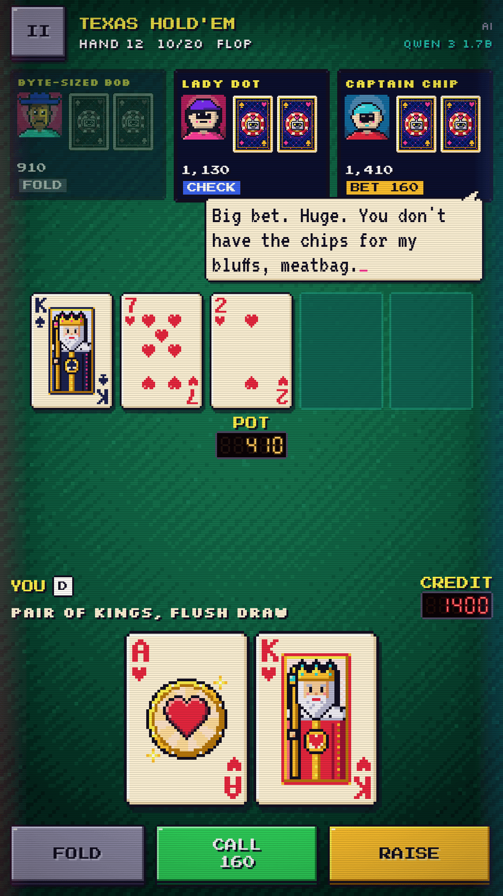
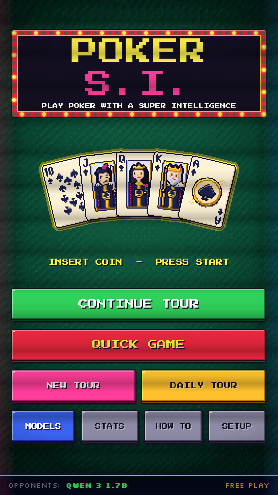
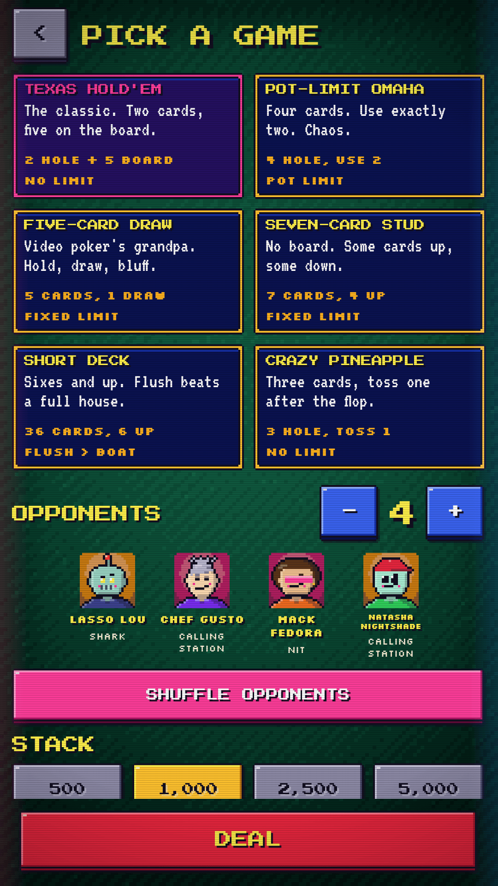
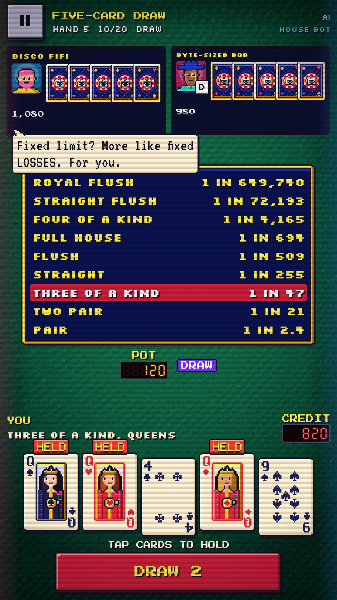
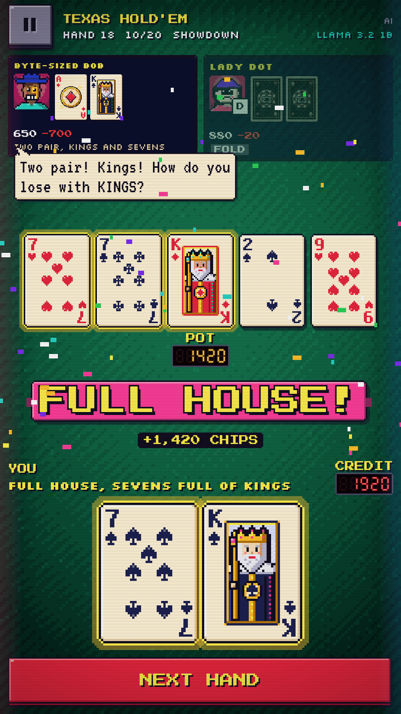
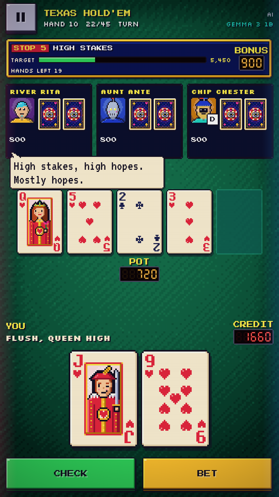
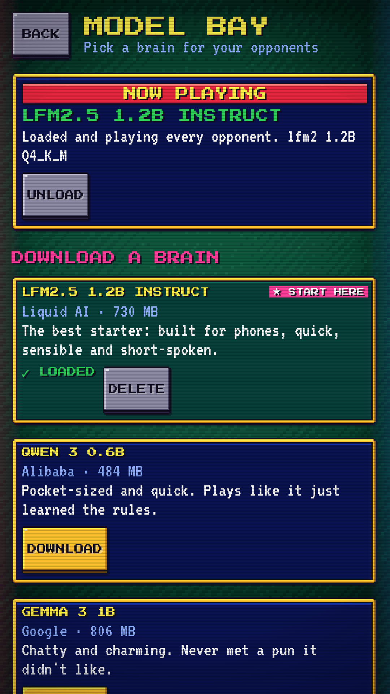
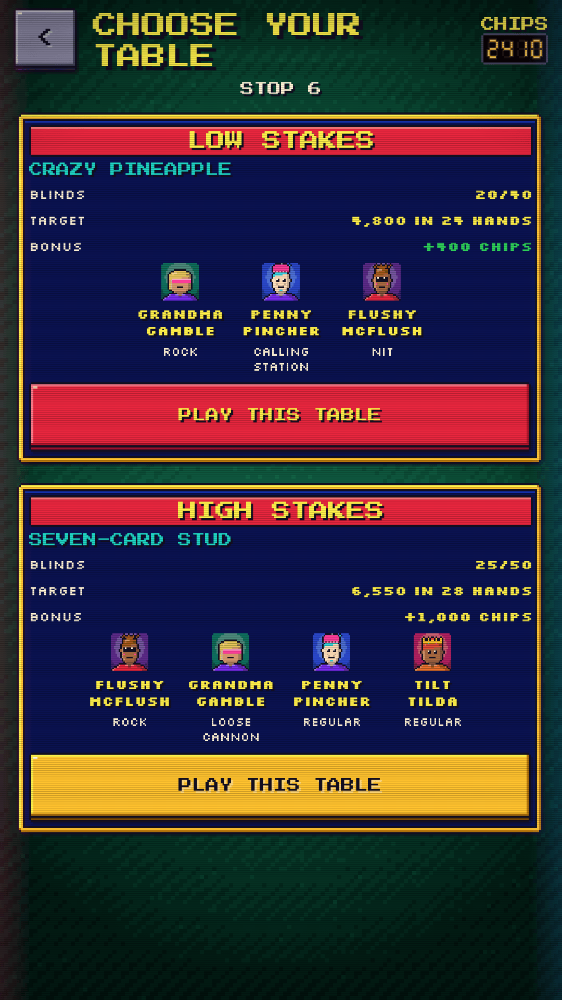
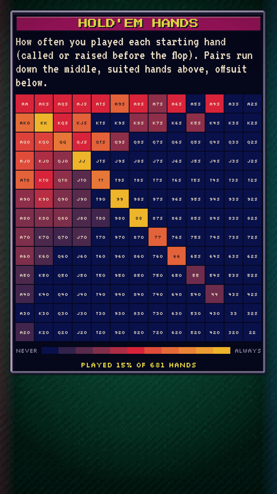
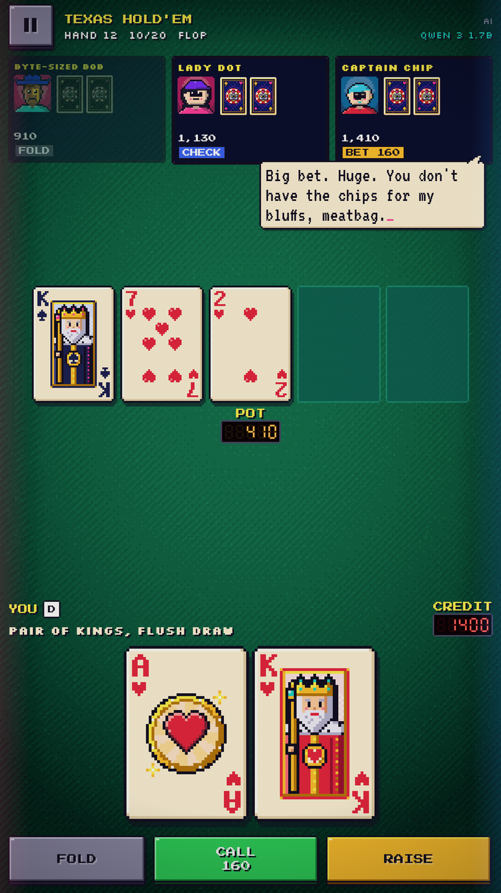

#  PokerSI

Play poker with a super intelligence. Or at least a very small one that
lives on your phone.

PokerSI is an Android poker game where every opponent is played by a
language model running **on the device** with
[llama.cpp](https://github.com/ggml-org/llama.cpp). It looks like a 90s
video poker cabinet on a green card table: chunky 8-bit cards, lamp-lit
pixel felt, CRT scanlines, marquee lights, LED pot counters, HOLD
buttons, and a table of quirky characters who bet, bluff and talk trash.
Six variants, a Poker Tour mode, and no network at all unless you
download a model.

<div align="center">
  
  <p><em><b>Texas Hold'em</b> — every seat is a persona played by the on-device model, trash talk included</em></p>
</div>

<table>
  <tr>
    <td align="center" width="33%"><p><em><b>Title</b> · pull up a chair</em></p></td>
    <td align="center" width="33%"><p><em><b>Six games</b> — pick one, pick your rivals</em></p></td>
    <td align="center" width="33%"><p><em><b>Five-Card Draw</b> — HOLD the keepers</em></p></td>
  </tr>
  <tr>
    <td align="center" width="33%"><p><em><b>Showdown</b> — full house!</em></p></td>
    <td align="center" width="33%"><p><em><b>Poker Tour</b> — stop 5, high stakes: hit the chip target in time</em></p></td>
    <td align="center" width="33%"><p><em><b>Models</b> — download one, or bring your own GGUF</em></p></td>
  </tr>
  <tr>
    <td align="center"><p><em><b>Poker Tour</b> — pick your next table: low stakes or high stakes</em></p></td>
    <td align="center"><p><em><b>Stats</b> — how often you played every Hold'em hand</em></p></td>
    <td></td>
  </tr>
</table>

<div align="center">
  
  <p><em><b>Tablet</b> — the same cabinet, bigger cards</em></p>
</div>

## What it is

- **The AI does the playing.** Each opponent is a randomly rolled persona
  (a name, a procedural pixel face, a personality) played by the loaded
  model. Every decision is a fresh, self-contained prompt: the persona, the
  rules, what that seat can see, the legal actions and its current hand in
  plain words. The reply is held to a tiny JSON shape by a grammar
  (`{"action": "raise", "amount": 120, "say": "..."}`, the decision first), the line it says
  shows up in a speech bubble, and the action is clamped to something legal.
- **Table talk, if you want it.** SETTINGS > TABLE TALK (off by default:
  small models like to blurt out their cards, and quiet turns are faster)
  lets the characters chat in speech bubbles. Each turn a character gets a
  different nudge (react to the last bet, answer whoever spoke, tease
  someone, the pot, the board, something in character) plus what was just
  said at the table, so they banter with each other. The table remembers
  every line: a character that starts repeating itself (or anyone else) is
  cut off before the line shows. Characters talk on some turns, not every
  one, which also keeps the game quick: a quiet turn is a shorter prompt and
  a shorter reply.
- **No waiting on hands you're out of.** With FAST FOLD (on by default),
  once you fold the rest of the hand plays out at once.
- **House Bot when there's no model.** With nothing loaded, a built-in
  heuristic opponent plays every seat and the table says so. It also steps
  in for any decision the model fumbles or takes too long on, so a hand
  never stalls. The game never waits on a download.
- **Fair dealing.** Decks are shuffled from a seed, and each opponent only
  ever sees what its seat may know: its own cards, the board, the bets.
- **Retro on purpose.** Pixel cards and fonts, lamp-lit pixel felt, a CRT
  overlay, LED digits and chiptune bleeps.
- **Private.** No account, no ads, no analytics. The only network use is
  downloading a model you pick, from Hugging Face.
- **Stats.** Lifetime hands played and won, win rate, biggest pot, your
  favorite game, Poker Tour bests and the best hand you've ever held,
  dealt out as pixel cards, plus a 13x13 Texas Hold'em chart of how often
  you played each starting hand (tap one for its numbers). They stay on the
  phone; RESET STATS wipes them.
- **First-run tips.** One screen on first launch says what nobody would
  guess (the AI lives on your phone, MODELS, the two modes, HOLD, pause).
  A tap dismisses it; SETTINGS > SHOW TIPS brings it back.
- **Accessible.** TalkBack reads cards ("Ace of hearts, held"), opponents
  (name, chips, last action, what they say), the pot and your chips, and
  announces each action at the table.
- **Debug console.** For the curious: turn on SETTINGS > DEBUG CONSOLE and
  a "~" at the table (and in MODELS, or a keyboard's backtick) drops down a
  Quake-style terminal with every prompt sent to the model, its raw reply as
  it streams, timings and tokens per second, the decision before and after
  it was made legal, every House Bot fallback and why, and model loads and
  failures. Filter, clear, or copy it as plain text. Off by default, and it
  records nothing while off.
- **No nagging.** Share, rate on Google Play, send feedback (a GitHub
  issue), the privacy policy and the source code are plain links under
  SETTINGS > ABOUT, never a prompt.

## The games

| Game | Deal |
|---|---|
| **Texas Hold'em** | Two hole cards, five community cards |
| **Pot-Limit Omaha** | Four hole cards, use exactly two of them with three from the board |
| **Five-Card Draw** | Five cards, tap **HOLD** on the keepers, draw once |
| **Seven-Card Stud** | Three down, four up, no board |
| **Short Deck** | Sixes and up (36 cards); a flush beats a full house, and A-6-7-8-9 is a straight |
| **Crazy Pineapple** | Three hole cards, discard one after the flop, then play Hold'em |

All-ins, side pots and split pots are handled by the engine, and a
how-to-play screen covers each game and the hand rankings.

## Poker Tour

A ladder of poker tables of rising stakes:

- **Escalating tables.** Win each table's chip target within its hand
  limit (or bust everyone) to clear it. Your chips carry over from table
  to table; go broke and the tour is over. Clear the tenth table to win,
  then keep going in endless mode.
- **Choose your next table.** After each table, pick from two: low
  stakes, or high stakes with an extra opponent, bigger blinds and a
  bigger target. Bigger risk, bigger chip bonus. Either way it's plain
  poker: no rule twists.
- **No dodging.** Leaving in the middle of a hand folds it.
- **Seeded and daily tours.** Every tour has a seed, and the daily tour is
  the same seed for everyone that day. The title screen shows your best
  daily result.

Quick games never run dry: when an opponent goes broke they leave the
table, and a new character sits down a hand later.

## Models

Open **Models** from the title screen.

- **Download a curated model.** A short list of small GGUF models, picked
  to play well and fit on phones, in the spirit of
  [LM Playground](https://github.com/andriydruk/LMPlayground). Downloads
  come straight from Hugging Face, run in the background with a progress
  notification, and land in the app's own storage. Tap one to load it.
- **Load your own GGUF files.** Pick a folder with the system file picker
  and every `.gguf` in it shows up in the list. Files are opened in place
  through the Storage Access Framework (by file descriptor, thanks to the
  [llama.cpp-android](https://github.com/andriydruk/llama.cpp-android)
  fork), so a multi-gigabyte model is never copied. Small instruction-tuned
  models (roughly 0.5B to 4B parameters, Q4 quantized) are the sweet spot.
- **No model?** House Bot plays. You can play every game and a whole tour
  without ever downloading anything.

The AI needs a reasonably recent 64-bit phone with a few gigabytes of free
memory and storage. llama.cpp ships one CPU backend per ARM feature level
(dotprod, i8mm, SVE…) and picks the best one for the phone at runtime.

## Latest Android, no compatibility code

PokerSI targets the latest public stable Android and the toolchain tracks
the latest Android Gradle Plugin and Gradle. It installs on Android 13 and
up, because that is the newest API the code uses (the `POST_NOTIFICATIONS`
permission, for download progress),
not because it carries code for older phones: there are no version checks.
Full policy in [`AGENTS.md`](AGENTS.md).

## Install

PokerSI isn't publicly listed on Google Play yet. Until it is, grab
`pokersi.apk` from the [latest release](../../releases/latest) and
sideload it. Every push to `main` publishes a single date-labeled release
(`vYYYY.MM.DD.N`) and deletes the previous one. The release also includes
`pokersi.aab` and `mapping.txt` for Google Play. Verify the APK with the
attached `pokersi.apk.sha256` (see [`SECURITY.md`](SECURITY.md)).

Requires Android 13 or newer.

## Building from source

llama.cpp is a git submodule, so clone recursively (or run
`git submodule update --init --recursive` in an existing clone):

```sh
git clone --recursive https://github.com/bradflaugher/PokerSI.git
cd PokerSI
./gradlew lint test assembleDebug          # full build, including llama.cpp
./gradlew -PskipNative test lintDebug       # fast: no native code
```

The full build needs JDK 21 and the Android SDK with the NDK and CMake
versions named in `app/build.gradle.kts` (`ndkVersion` and the `cmake`
version); the first native build takes a while. `-PskipNative` leaves
llama.cpp out entirely: no NDK, no submodule, and the app offers only
House Bot. Use it for unit tests, lint and screenshot work.

### Tests

The poker engine (`engine/`) and Run mode (`run/`) are pure Kotlin with no
Android imports, so their tests are plain JVM unit tests: the hand
evaluator, every variant's dealing, betting and side pots, Run mode's
tables and table choices, and the prompt builder, grammar and reply parser
that sit between the model and the table.

GitHub Actions runs the unit tests and lint on every pull request and push
to `main` (`.github/workflows/ci.yml`, with a per-suite summary on the run
page), the full native release build in `build-release.yml`, and CodeQL in
`codeql.yml`.

### Screenshots

The README and Play screenshots are rendered on the JVM, no emulator: the
real composables in scripted game states (`ScreenshotScenes`), drawn by
Robolectric's native graphics through Roborazzi.
[`tools/screenshots/shoot.py`](tools/screenshots/shoot.py) renders every
scene at each Play class (phone 1080×1920, 7-inch 1224×2176, 10-inch
1620×2880, all exactly 9:16) into `build/screenshots/`, then
[`caption.py`](tools/screenshots/caption.py) (ImageMagick, in the app's own
fonts and cabinet colors) adds a headline and subline to each one for
Google Play and writes them into `fastlane/metadata/android/en-US/images/`,
with the feature graphic and the 512px icon. The README shots in
`docs/screenshots/` (including the `icon.png` in the title above) stay
uncaptioned:

```sh
tools/screenshots/shoot.py               # render, caption, optimize
tools/screenshots/shoot.py --no-render   # only redo the captions
```

Signed release builds need all four of `POKERSI_KEYSTORE_PATH`,
`POKERSI_STORE_PASSWORD`, `POKERSI_KEY_ALIAS`, `POKERSI_KEY_PASSWORD` (or
none, for an unsigned build). CI restores the keystore from the
`POKERSI_KEYSTORE_BASE64` secret. Keeping the toolchain, llama.cpp and CI
current is covered in [`MAINTAINING.md`](MAINTAINING.md).

## Privacy

PokerSI has no account, ads, analytics or tracking, and turns backups off.
Games, settings and everything the opponents say stay on the phone, and so
does the AI. The app goes online only to download a model you chose, from
Hugging Face. Folders of your own models are opened read-only through the
system file picker. The full policy is at
<https://bradflaugher.com/privacy/pokersi/>.

## Credits

- [llama.cpp](https://github.com/ggml-org/llama.cpp) by the ggml authors
  (MIT), via the
  [llama.cpp-android](https://github.com/andriydruk/llama.cpp-android) fork
  by Andriy Druk (MIT).
- [LM Playground](https://github.com/andriydruk/LMPlayground) by Andriy Druk
  (MIT), the inspiration for the model catalog, background downloads,
  bring-your-own-GGUF folders and the native build setup.
- Pixel fonts under the SIL Open Font License (see `licenses/`).
- Models are downloaded from [Hugging Face](https://huggingface.co/) and
  carry their own licenses (see each model's Hugging Face page).

Poker hand names and rules are public domain. LM Playground is named only
as an inspiration; PokerSI is not affiliated with it.

## License

[MIT](LICENSE).
